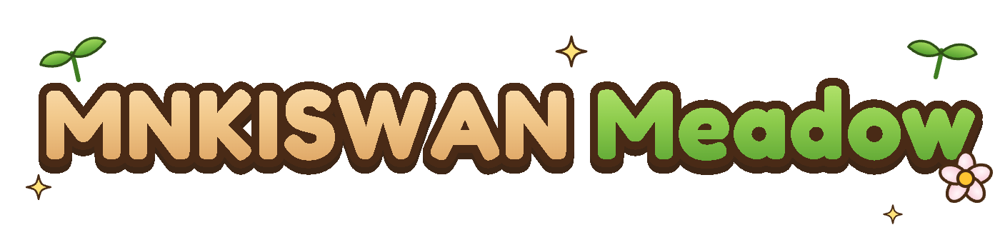
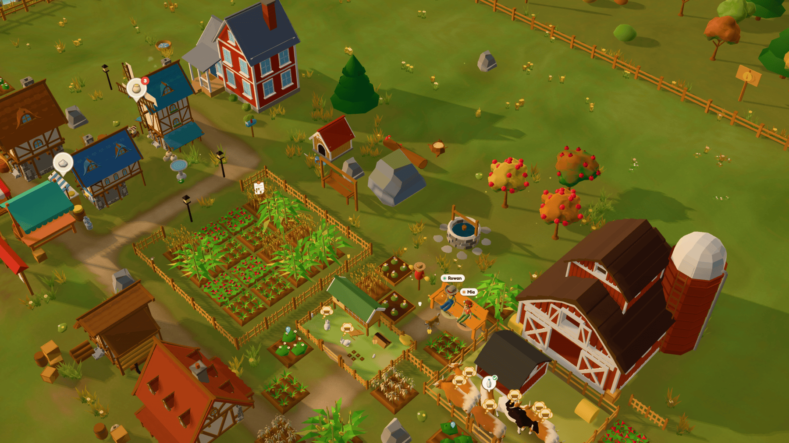
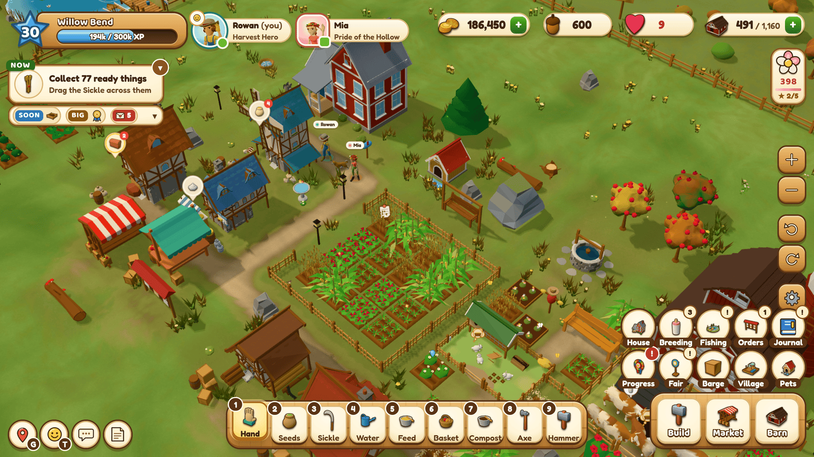
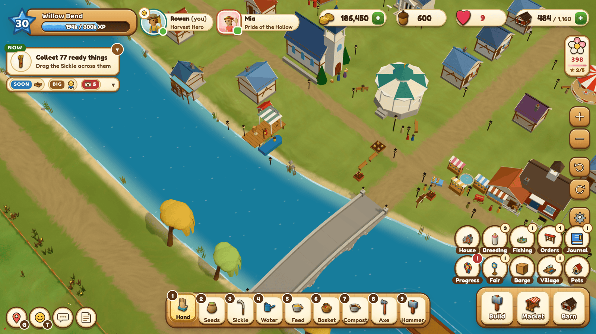

<p align="center">
  
</p>

<p align="center"><b>A cosy 3D farming game, right in your browser.</b><br>
Plant, harvest, raise animals, craft and grow a whole valley. Made with care by
<a href="https://mnkiswan.com/">MNKISWAN Studio</a>.</p>

<p align="center"><a href="https://mnkiswan.github.io/mnkiswan-meadow/"><b>▶ Play now in your browser</b></a> ·
English &amp; Български</p>

<p align="center">
  
</p>

## Two ways to play

- **In your browser (GitHub Pages):** open **[mnkiswan.github.io/mnkiswan-meadow](https://mnkiswan.github.io/mnkiswan-meadow/)**.
  No account and no download. The whole farm, rules engine included, runs on your device and is saved in your
  browser (IndexedDB), so it is waiting for you next time on the same browser. This edition is for one player per
  browser. Clearing the site's data deletes the farm.
- **Together, on your own server:** run the Node server below and two farmers share **one** farm in real time.
  One plants, the other harvests. One runs the bakery while the other feeds the cows, and both of you see everything
  the moment it happens.

## Features

- **A whole valley, 40 levels deep**: 25 crops from Wheat to Roses, 16 kinds of trees that age a year with every
  harvest, and 12 kinds of animals, from chickens and rabbits to bees, horses, alpacas and bison, with babies and
  breeding.
- **Craft everything**: 18 workshops and 136 recipes, queues you drag to reorder, and Compost and Fertilizer for
  bigger, faster harvests.
- **Always a next goal**: an orders board, illustrated story letters from the townsfolk, 64 quests, 68 ribbons,
  12 collection albums, a seasonal ribbon track, a weekly County Fair, the River Barge, Town Projects and restoration
  projects ending with Grandma's farmhouse.
- **Surprises**: the hot-air balloon drops loot crates, and rare Acorn treasures are worth saving up for.
- **Make it yours**: 115 decor pieces, upgrades for the farmhouse, the Well and the Market Stand, a farmer look of
  your own, and a dog and a cat.
- **Feels good to play**: drag across fields to plant and harvest, click anywhere to walk, and every action is
  instant.
- **Cosy look and sound**: a low-poly 3D world with day and night, seasons, rain and rainbows, glowing windows after
  dark, and an acoustic folk soundtrack that follows the time of day.
- **Phones and tablets**: touch controls, a phone layout and a lighter graphics mode.

<p align="center">
  
  
</p>

## How to play

| | Mouse / keyboard | Touch |
|---|---|---|
| Act on something | click it with the Hand (1) | tap |
| Plant / harvest a field | pick Seeds (2) or the Sickle (3), drag across plots | drag a finger |
| Plant on an empty plot | click it with the Hand → seed picker | tap it |
| Walk | click open ground | tap open ground |
| Camera | right-drag pan, wheel zoom, Q / E turn, PageUp / PageDown tilt | two fingers pan, pinch zoom, twist to turn |
| Move or turn a building | the Hammer (9), then click it; R turns it | the Hammer, then tap it; ⟳ turns it |
| Item info | hover any item | hold any item |

Grandma Hazel's two short guides teach the rest in game. Settings › Controls lists every key and gesture.

## Run your own server (two farmers, one farm)

You need [Node.js 24](https://nodejs.org/).

```sh
git clone https://github.com/mnkiswan/mnkiswan-meadow.git
cd mnkiswan-meadow
npm install
npm start
```

Open **http://localhost:3300**, pick a farmer, a name and a colour, and play. Your partner opens the home-network
address the server prints (for example `http://192.168.x.y:3300`) and picks the other farmer. Set
`HH_PASSPHRASE='something-only-you-know'` before you share the farm beyond your home network.
[deploy/cloud.md](deploy/cloud.md) and [`deploy/mnkiswan-meadow.service`](deploy/mnkiswan-meadow.service) cover running
it 24/7. The in-game helper, Harvey, works on a self-hosted server only.

## Build the GitHub Pages edition

```sh
npm install
BASE=https://<user>.github.io/<repo> node tools/build-pages.mjs   # writes dist-pages/
```

[`.github/workflows/pages.yml`](.github/workflows/pages.yml) does this on every push to `main` and deploys it.

The browser edition runs the real server code inside the page: [`public/js/local/host.js`](public/js/local/host.js)
wires `server/engine.js`, `sessions.js`, `router.js`, the scheduler and the rest the way `server/app.js` does, with
the save kept in IndexedDB ([`idb-persist.js`](public/js/local/idb-persist.js)) and an in-page socket in place of
`ws`. The game client is unchanged and talks the same protocol.

## How it works

- `shared/`: the whole game in pure, deterministic JavaScript: content tables and the rules engine. The same code
  runs in the browser to predict an action instantly and on the server to decide it.
- `server/`: Express + `ws`: one authoritative farm in memory, an action journal, snapshots and backups, presence, rate
  limits and a scheduler for daily and weekly events.
- `public/`: the client: Three.js with no bundler (an import map) and an HTML/CSS interface.
- `tools/`: the economy model and simulators, the asset pipeline, the Pages build and end-to-end tests.

```sh
npm test                          # unit and integration tests (node:test)
node tools/econ-sim.mjs --checks  # the economy's pacing and balance checks
```

## Credits

- **MNKISWAN Meadow** by [MNKISWAN Studio](https://mnkiswan.com/), a two-person studio in India and Poland.
- Built on the open-source game [Harvest Hollow](https://github.com/KrasimirKralev/harvest-hollow) by Krasimir Kralev
  (MIT licence). Its design documents are kept in [`docs/`](docs).
- 3D models: [Quaternius](https://quaternius.com), [Kenney](https://kenney.nl) and
  [vertexcat](https://vertexcat.itch.io) (CC0). The packs are listed in
  [`public/assets/models/CREDITS.md`](public/assets/models/CREDITS.md).
- Music: CC0 tracks from [OpenGameArt](https://opengameart.org) by Komiku, Memoraphile, Écrivain, Indieteur and
  RandomMind. Details are in [`public/assets/audio/music/CREDITS.md`](public/assets/audio/music/CREDITS.md).
- Fonts: Fredoka, Baloo 2 and Nunito (SIL Open Font License 1.1; the licence texts are in `public/assets/fonts/`).
- Built with [three.js](https://threejs.org), [Express](https://expressjs.com) and [ws](https://github.com/websockets/ws).

## Privacy and license

The browser edition keeps everything in your own browser: [privacy](https://mnkiswan.github.io/mnkiswan-meadow/privacy/).
A self-hosted server keeps everything on your own machine ([PRIVACY.md](PRIVACY.md)).

Code and the game's own art: [MIT](LICENSE). Third-party assets keep their own licences (see Credits).
